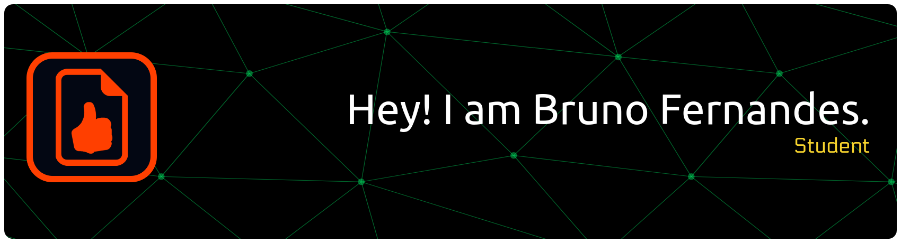

# 👋 Hi, I’m Bruno Fernandes (`brnfrnds`)

**“School Things…”**  

🎓 Student of Computer Engineering at **Universidade do Algarve (UAlg), Portugal**  
🏎️ Software & IT Department Leader at [FS-ERTA](https://fs-erta.com)
📍 Based in Algarve, Portugal  
📺 Creator / tech content on YouTube: [@zinixoficial](https://www.youtube.com/@zinixoficial) | [@zinixtech](https://www.youtube.com/@zinixtech)  
📸 I also share visual / personal content: [Instagram — brnfrnds](https://www.instagram.com/brnfrnds) | [Instagram — zinixproduciones](https://www.instagram.com/zinixproduciones)

---

## 🛠️ Skills & Interests

Here are some of the things I like to tinker with:

- Programming languages & frameworks: **JavaScript**, **Python**, **C**, **Electron.JS**
- Web / front-end / back-end development  
- Algorithms & problem-solving ~~ 
- Embedded systems / hardware integration (arduinos and other stuff)
- Tech content creation & showcases  
- Learning new tools, exploring open source  

---

## 📂 Featured Projects

> *I've pinned some repositories that I’m especially proud of. Feel free to explore!*

- **zinixyt/meetballs-embedded-workshop** — A session I held at [MeetBalls](https://meetballs.org/).
- **mipsclass** — A custom multiplayer 3D environment with a actual MIPS engine for learning assembly like the 80s.
- (private) **StoreYaDocs** — A fast-access file storage system with Google Drive integration, focused on tags, albums and collections.
- (private) **TourNEiTo** — A ready to deploy E-Sports Tournament Framework with website integration and Live Broadcast-ready visuals.
- (private) **Microscopium** — A simple visual effects manager for microscopes with OCR (Optical Character Recognition) integration.
- (private) **CenaBank** — A netbanking app that attempts to apply all current security standards.
- (private) **MeuOneBot** — A web interface for real-time data capture and analysis from a Line Follower Robot.
- (private) **MegaNinho** — A back-office web-app for team management at [ERTA](https://fs-erta.com)
- (private) **NeoTelemetrica** — A custom full-stack telemetry system for ultra-fast network-connected race cars monitoring.

Feel free to contact me if you're interested.

---

## 📈 GitHub Stats & Activity

  

  

---

## 📬 Connect with Me

- YouTube: [@zinixoficial](https://www.youtube.com/@zinixoficial) | [@zinixtech](https://www.youtube.com/@zinixtech)  
- Instagram: [brnfrnds](https://www.instagram.com/brnfrnds) | [zinixproducciones](https://www.instagram.com/zinixproducciones)  
- Email: **[brunomcf07@gmail.com](mailto://brunomcf07@gmail.com)**  

---

## 🎯 What’s Next

- Deepen my skills in **Web Frameworks**, **C**, and **Cyber-Security**  
- Build and ship open-source tools  
- Collaborate with others on meaningful projects  
- Share more tutorials, code walkthroughs, and tech insights  

Thanks for stopping by! 👋  
Let’s build something cool together.
